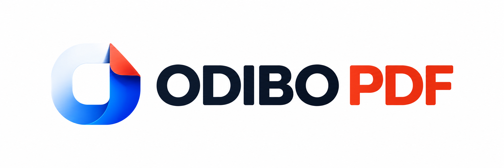
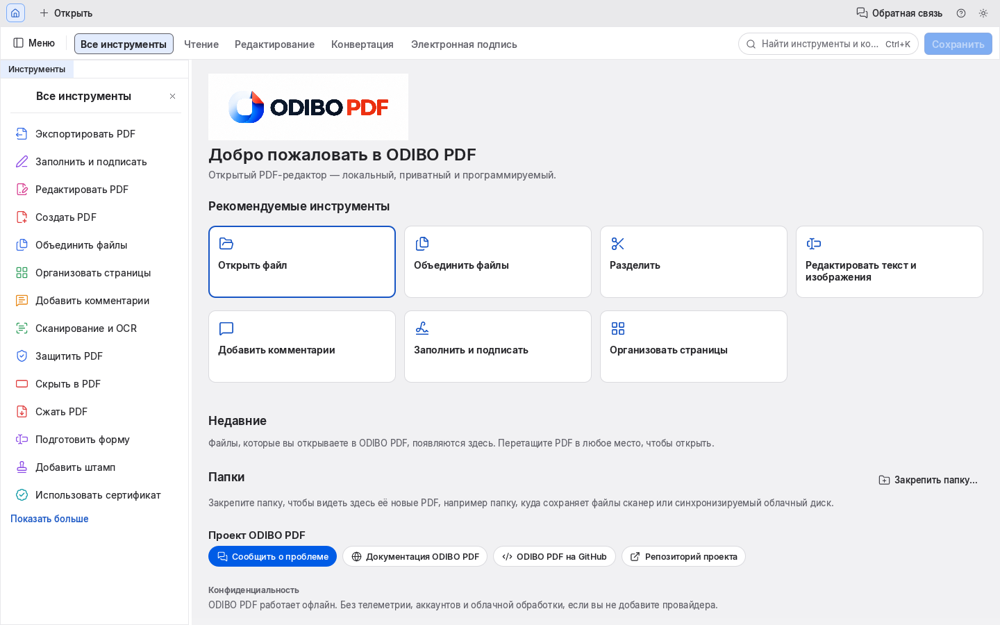
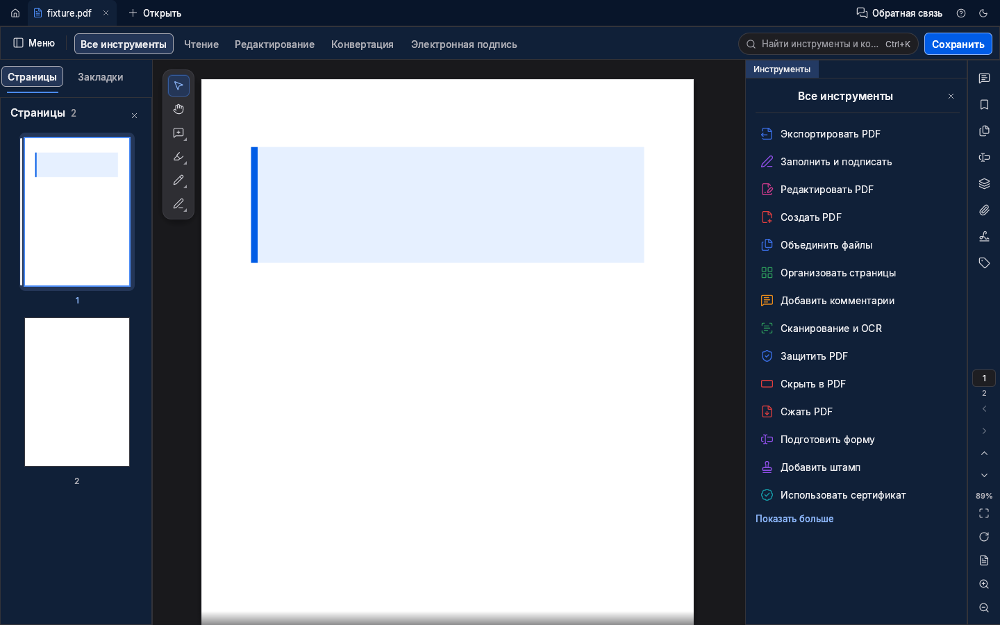
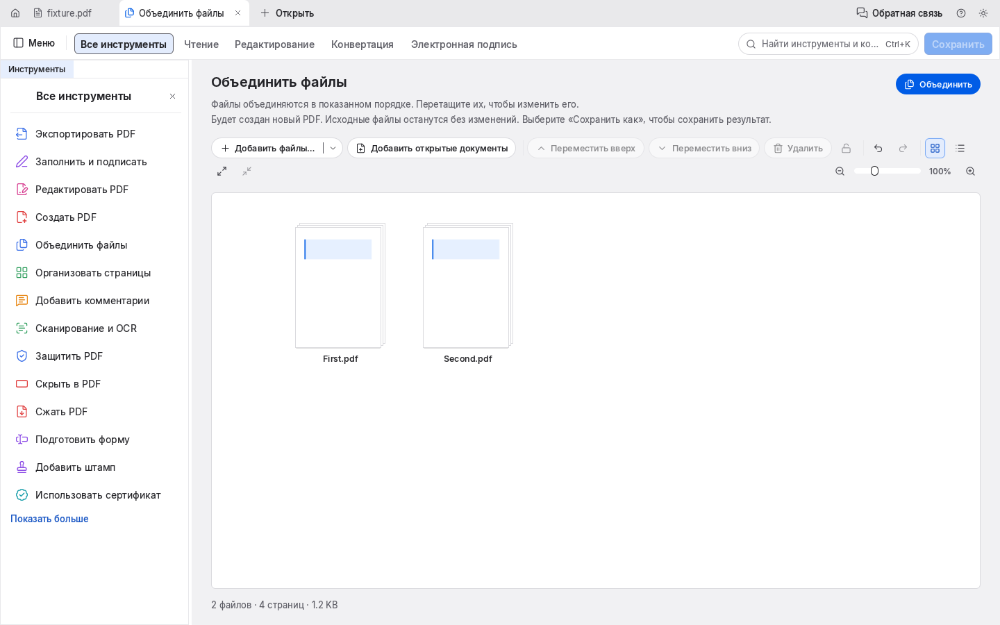
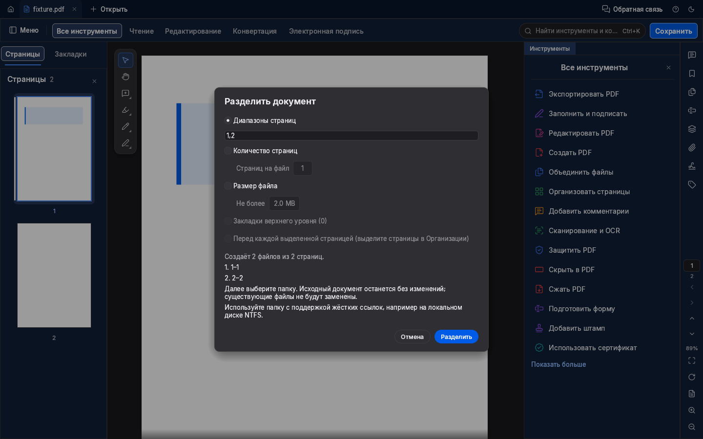
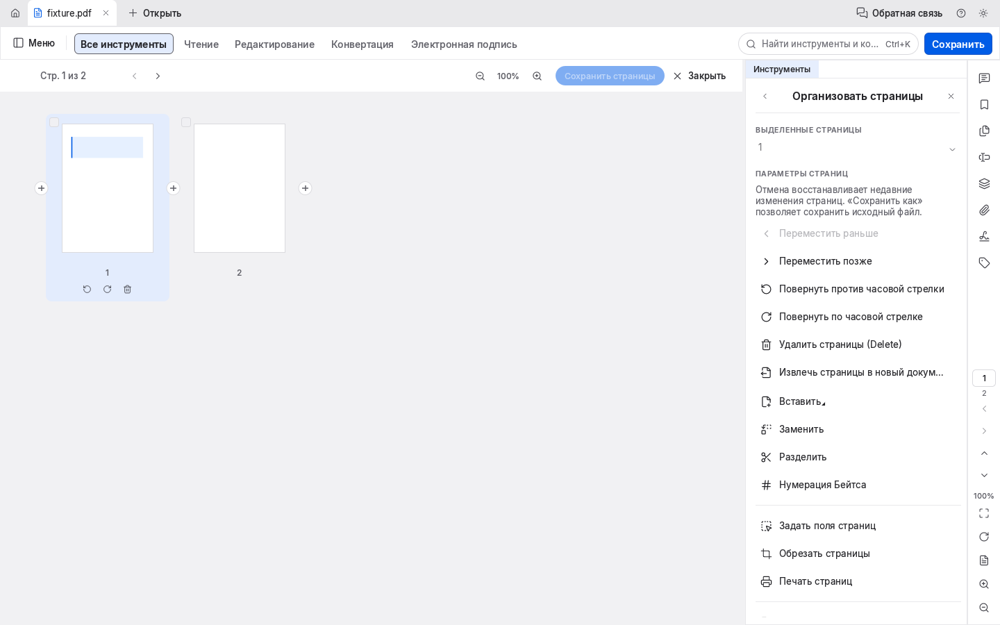

<p align="center">
  
</p>

# ODIBO PDF

**Локальное приложение для Windows: чтение, объединение, разделение PDF, организация страниц и аннотации.**

Написано на Rust и egui. **IMR4N** развивает приложение под самостоятельным брендом на основе [PdfCraft](https://github.com/storytold/pdfcraft).

[English](README.md) · [Тестовая сборка Windows](#тестовая-сборка-windows-x64) · [Ограничения](#статус-и-ограничения) · [Сборка из исходников](#сборка-из-исходников)



*Настоящий интерфейс Rust/egui, снятый на временном Linux-окружении GitHub Actions с синтетическими документами. Это не скриншоты нативной Windows-версии. [Происхождение и лицензии изображений](docs/screenshots/odibo/PROVENANCE.md).*

## Возможности

| Задача | Доступный сценарий |
|---|---|
| Читать PDF | Открывать файлы и недавние документы, переходить по страницам и миниатюрам, искать текст и менять масштаб. |
| Объединять | Добавлять или перетаскивать несколько PDF, просматривать и менять порядок, удалять лишние файлы, создавать новый документ и выбирать «Сохранить как». |
| Разделять | Использовать существующие режимы или проверяемые последовательные диапазоны, просматривать состав результатов и выбирать папку. |
| Организовывать страницы | Выделять несколько страниц, перемещать, поворачивать, удалять и добавлять страницы; использовать отмену и повтор. |
| Аннотировать и заполнять | Добавлять комментарии и поддерживаемые аннотации, заполнять формы, использовать Fill & Sign. Нарисованная подпись не является цифровой подписью на основе сертификата. |
| Редактировать и экспортировать | Использовать существующие инструменты текста и изображений и поддерживаемые форматы экспорта с ограничениями ниже. |
| Автоматизировать | Запускать CLI, JSON-сценарии или явно включённый MCP-сервер. Агентские серверы не включаются автоматически. |

Есть русский и английский интерфейсы, светлая и тёмная темы, масштабирование. Повседневные PDF-операции выполняются локально без обязательного аккаунта и загрузки в облако. Дополнительные провайдеры и внешние ссылки используются по отдельному действию пользователя.

## Интерфейс

| Редактор · тёмная тема | Объединение · светлая тема |
|---|---|
|  |  |

| Разделение · тёмная тема | Организация страниц · светлая тема |
|---|---|
|  |  |

На скриншотах настоящее приложение с разрешёнными встроенными шрифтами и синтетическими документами. Это не HTML-макеты и не личные PDF. Изображения хранятся в репозитории; происхождение и SHA-256 учтены в [ATTRIBUTION.toml](ATTRIBUTION.toml).

## Тестовая сборка Windows x64

**Это тестовое приложение без цифровой подписи, а не официальный стабильный релиз.** Постоянной ссылки на бинарную сборку, установщика и настроенного автоматического обновления пока нет.

1. Откройте [Actions → ODIBO Windows test build](https://github.com/imranOdiboev/pdfcraft/actions/workflows/odibo-foundation.yml).
2. Выберите **успешный** запуск для нужной ветки или PR. Ссылку на проверяемую сборку берите из соответствующего PR: успешная сборка сама по себе не означает приёмку владельцем.
3. Войдите в GitHub и скачайте `odibo-rebranding-windows-x64-…` в разделе **Artifacts**. Старое имя артефакта сохранено. Срок хранения — **семь дней**. Если подходящего артефакта нет, действующей ссылки на скачивание пока нет.
4. Распакуйте **весь ZIP** в папку с правом записи и запустите `odibo-pdf.exe`. Сохраните вместе `models/`, `licences/`, оба EXE, уведомления и лицензии.

Windows может показать предупреждение о неподписанном приложении. Перед запуском проверьте репозиторий, запуск, коммит и контрольные суммы. Эта инструкция не требует отключать защиту Windows. В архиве есть сведения о сборке и файлы контрольных сумм.

Маркер `portable.txt` хранит данные приложения в `ODIBOPDFData` рядом с EXE. Удалите маркер перед запуском, если хотите использовать отдельные пользовательские папки ODIBO. Начинайте с копий несекретных тестовых документов. Для сохранения оригинала выбирайте «Сохранить как».

## Статус и ограничения

ODIBO PDF активно разрабатывается. Текущая основная платформа — Windows x64. В исходном коде есть другие настольные платформы и WebAssembly, однако готовые Web- и Android-продукты, производственная готовность и полное соответствие другому PDF-редактору не заявляются.

- При редактировании существующего текста и отображении сложных PDF возможны ограничения точности. Office-экспорт может терять вёрстку; встроенного импорта Office → PDF нет. Подробности: [известные пробелы](docs/gaps.md) и [поддержка форматов](docs/file-format-parity.md).
- OCR распознаёт **английский текст и базовую латиницу**. Текущая модель **не поддерживает русский OCR**. Русский язык интерфейса не означает распознавание русских сканов.
- Пакетный OCR в настольном приложении выполняется в фоне; кнопки отмены для него пока нет.
- Явные диапазоны разделения должны последовательно покрывать весь документ без пропусков и пересечений. Для отдельных выбранных страниц используйте существующее извлечение.
- Безопасная запись результатов разделения, извлечения в отдельные файлы и пакетного OCR требует папки на файловой системе с жёсткими ссылками, например NTFS. Для неподдерживаемой папки операция безопасно отклоняется. Если ошибка возникнет на следующем результате, уже записанные новые файлы могут остаться: пакетная запись не является единой транзакцией.
- Разделение синхронное и на больших PDF может временно задерживать интерфейс. Отмена объединения отбрасывает результат, но не прерывает уже запущенный шаг ядра.
- История отмены хранит до 100 последних изменений. Важные файлы проверяйте на копиях, сохранённый результат открывайте повторно.

[Дорожная карта](ROADMAP.md), [архитектура](docs/architecture.md) и [оценка исходного проекта](docs/target-app-parity.md) описывают более широкую кодовую базу. Исторические измерения PdfCraft не являются новыми замерами ODIBO или результатами пользовательского исследования.

## Сборка из исходников

При наличии указанного проектом Rust toolchain и системных компонентов:

```sh
cargo build --locked --release -p pdfcraft -p pdfcraft-cli
cargo test --locked --workspace
cargo clippy --locked --workspace --all-targets -- -D warnings
cargo xtask assets
```

Внутренние имена пакетов Cargo сохранены: `pdfcraft`. Исполняемые файлы — `odibo-pdf` и `odibo-pdf-cli` (`.exe` в Windows). Полный прогон выполняет CI на временных runner. Для OCR при сборке из исходников выполните `cargo xtask models`; в тестовом Windows-архиве модели и уведомления уже включены. Дополнительные шрифты поставляются из закреплённого craft-fonts: см. [AGENTS.md](AGENTS.md) и [workflow сборки](.github/workflows/odibo-foundation.yml).

```sh
cargo run --locked --release -p pdfcraft-cli -- --help
cargo run --locked --release -p pdfcraft-cli -- tools
cargo run --locked --release -p pdfcraft-cli -- run --script steps.json --root ./test-files
```

MCP запускается только командой `odibo-pdf-cli mcp`. Аутентифицированный канал управления UI на loopback также включается явно. См. [документацию автоматизации](crates/automation/README.md).

Сборка без фирменной графики возможна даже без папки `assets/odibo/`:

```sh
cargo build --locked -p pdfcraft --features unbranded
```

Это исключает графические ресурсы ODIBO. Для отдельного изменённого продукта при распространении нужно также выбрать собственную идентичность согласно условиям бренда.

## Лицензии, происхождение и благодарности

Благодарим **PdfCraft и его участников** за исходное приложение. ODIBO PDF — самостоятельная изменённая версия; одобрение со стороны авторов исходного проекта не заявляется.

Открытый код сохраняет [MIT](LICENSE-MIT) **OR** [Apache-2.0](LICENSE-APACHE), исходные сведения об авторах и [NOTICE](NOTICE). Зависимости, шрифты и OCR-модели сохраняют собственные лицензии: [ATTRIBUTION.md](ATTRIBUTION.md), [лицензионные уведомления](docs/ODIBO_LICENSE_NOTICES.md).

**Логотипы, иконки и технические производные ODIBO имеют отдельные условия:** [LicenseRef-ODIBO-Brand](assets/odibo/LICENSE-ODIBO-BRAND.txt), а не MIT/Apache-2.0. Представитель проекта IMR4N сообщил, что два исходных изображения созданы через OpenAI ChatGPT специально для проекта; это отражено в [происхождении бренда](assets/odibo/PROVENANCE.md). Исключительные авторские права на полностью сгенерированные ИИ элементы и регистрация товарного знака не заявляются. Условия не ограничивают права на открытые компоненты, неохраняемые материалы и законные фактические упоминания. Скриншоты можно распространять для описания и обзора ODIBO PDF; элементы бренда сохраняют отдельные условия.
